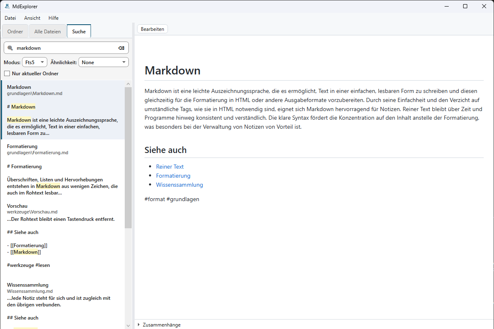
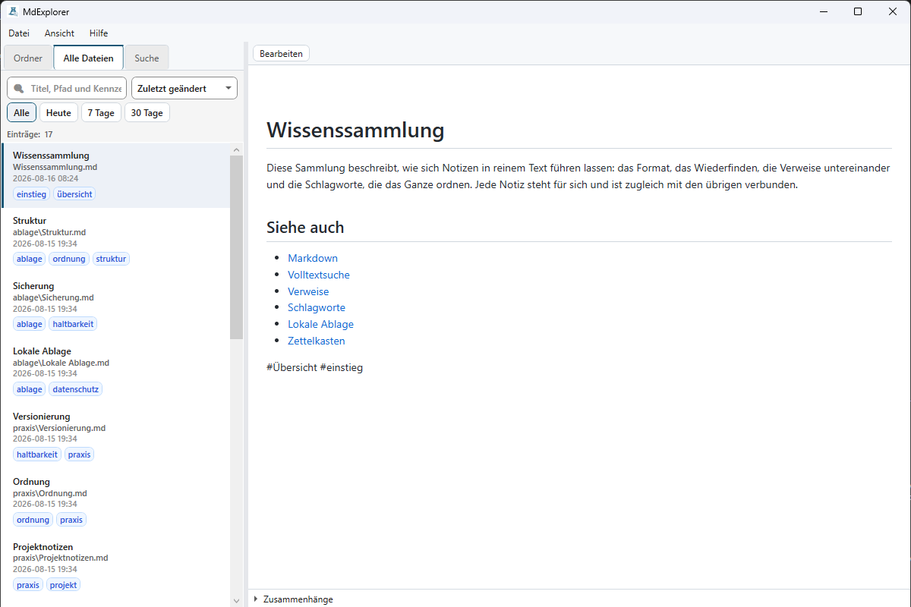
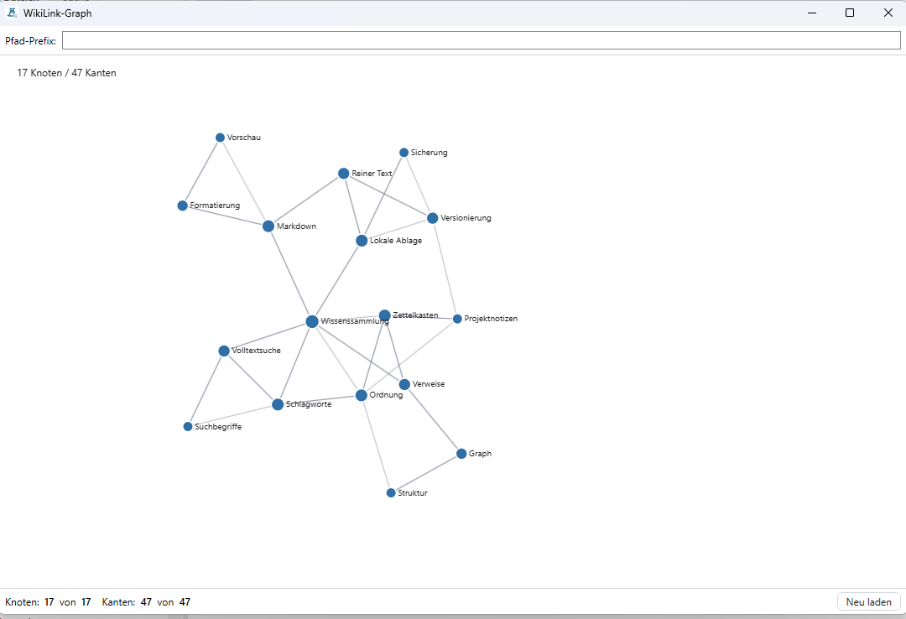
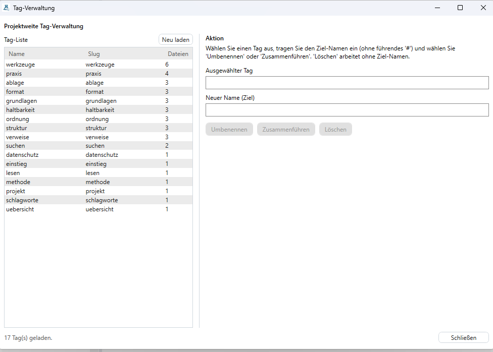

# MdExplorer

[](https://github.com/ReneSchustek/mdExplorer/actions/workflows/ci.yml)
[](LICENSE)
[](https://dotnet.microsoft.com/)

Ein Ordner voller Markdown-Notizen wird ab einer gewissen Größe unübersichtlich:
Man weiß noch, dass etwas notiert wurde, aber nicht mehr, wo, und schon gar nicht,
welche Notiz mit welcher zusammenhängt. MdExplorer indexiert solche Bestände und
macht sie erkundbar: Volltextsuche über alles, Schlagwörter projektweit pflegbar,
die Verweise zwischen den Notizen als Graph und eine Vorschau, in der sich jede
Datei direkt bearbeiten lässt.

Alles läuft lokal. Kein Konto, kein Server, keine Cloud: Der Suchindex liegt in einer
SQLite-Datenbank im Benutzerprofil (`%LOCALAPPDATA%\MdExplorer`), die Notizen bleiben,
wo sie sind, und ohne Internetverbindung funktioniert die Anwendung vollständig.

Windows-Desktop-Anwendung, gebaut mit WPF auf .NET 10: oben eine schlanke Kopfleiste mit
den Werkzeugen, links Ordner, Dateiliste und Suche als Register, rechts die HTML-Vorschau auf Basis von WebView2 mit Editor, dazu
eine einblendbare Tag-Cloud. MIT-Lizenz.

## Oberfläche

Volltextsuche mit Trefferstellen und Vorschau:



Alle Dateien mit Tags, Zeitraum-Filter und Änderungsdatum:



Verweise zwischen den Notizen als Graph:



Tags umbenennen, zusammenführen oder löschen:



## Voraussetzungen

**Zum Benutzen:** Windows und die
[WebView2-Runtime](https://developer.microsoft.com/microsoft-edge/webview2/), die auf
aktuellen Windows-Installationen bereits vorhanden ist. Mehr braucht es nicht, SQLite bringt die
Anwendung über das Paket `Microsoft.Data.Sqlite` selbst mit.

**Zum Bauen:** zusätzlich das .NET 10 SDK.

## Installation

Fertige Fassungen liegen auf der
[Releases-Seite](https://github.com/ReneSchustek/mdExplorer/releases/latest): ein
Windows-Installer samt SHA-256-Prüfsumme und Signatur und ein Archiv zum Entpacken. Das
Archiv läuft aus jedem beliebigen Ordner, ohne Installation.

Der Installer trägt **kein Windows-Codesignatur-Zertifikat**. Windows zeigt beim ersten
Start deshalb eine Warnung, die sich über „Weitere Informationen" übergehen lässt.

Die Update-Funktion in den Einstellungen lädt nur von der Releases-Seite dieses
Repositorys und installiert nur ein Setup, dessen Signatur zum in MdExplorer eingebauten
Schlüssel passt. Fehlt die Signatur oder passt sie nicht, bleibt der Weg über die
Releases-Seite.

### Markdown-Dateien per Doppelklick öffnen

Das Setup meldet MdExplorer bei Windows als Programm für `.md` und `.markdown` an. Es steht
danach unter „Öffnen mit“; zum Standardprogramm wird es dort einmal mit „Immer“, denn diese
Wahl lässt Windows kein Setup treffen. Ein Doppelklick öffnet die Datei dann im
Dokumentbereich, auch wenn sie in keinem indizierten Ordner liegt.

Läuft MdExplorer schon, öffnet die Datei im vorhandenen Fenster, und das Fenster kommt nach
vorn; eine zweite Instanz auf derselben Datenbank entsteht nicht. Hält der Editor
ungespeicherte Änderungen, fragt MdExplorer vorher wie bei jedem Wechsel der Datei. Das
Deinstallieren entfernt die Zuordnung wieder.

Wer das Archiv ohne Setup nutzt, wählt `MdExplorer.exe` über „Öffnen mit → Andere App
auswählen“ selbst aus. Die Datei als erstes Argument versteht das Programm auch von der
Befehlszeile:

```powershell
MdExplorer.exe "D:\Notizen\Plan.md"
```

Die Fassung trägt noch eine **Null vor dem Punkt**, und das ist eine Aussage: Die
Anwendung tut, was sie soll, und ist täglich im Einsatz, aber Einstellungen,
Datenbankformat und Bedienung sind nicht eingefroren. Eine spätere Fassung darf
Dinge anders machen.

### Aus dem Quelltext bauen

```powershell
git clone https://github.com/ReneSchustek/mdExplorer.git MdExplorer
cd MdExplorer
dotnet restore MdExplorer.slnx
```

### Veröffentlichen und Installer

Die auslieferbare Fassung ist eine einzelne, eigenständige `MdExplorer.exe`; ein
installiertes .NET braucht sie nicht. Die Version steht in der Datei `VERSION`.

```powershell
$version = (Get-Content VERSION -Raw).Trim()
dotnet publish src/MdExplorer.App/MdExplorer.App.csproj -c Release -r win-x64 `
    --self-contained true -p:PublishSingleFile=true `
    -p:IncludeNativeLibrariesForSelfExtract=true -o publish
& "C:\Program Files (x86)\Inno Setup 6\ISCC.exe" "/DSourceDir=$((Resolve-Path publish).Path)" `
    "/DMyAppVersion=$version" installer\MdExplorer.iss
```

Das Setup landet in `dist\MdExplorer-<Version>-setup.exe`. Ohne `/DMyAppVersion`
bricht Inno Setup ab, damit kein Setup mit falscher Versionsnummer entsteht.

Ein Release entsteht über einen Tag `v<Version>`. Der Workflow
`.github/workflows/release.yml` prüft, dass der Tag zu `VERSION` passt, baut und
testet die Lösung und veröffentlicht danach Archiv, Setup, dessen SHA-256-Prüfsumme und
Signatur. Den privaten Schlüssel erwartet er im Secret `RELEASE_SIGNING_KEY`. Ist es nicht
hinterlegt, bricht der Workflow nach Build und Tests ab, ohne etwas zu veröffentlichen; Setup,
Prüfsumme und Signatur entstehen dann lokal und werden von Hand an das Release gehängt.

Die Signatur ist ECDSA mit P-256 über SHA-256 des Setups, im DER-Format; dasselbe liefert
`openssl dgst -sha256 -sign <privater-schlüssel.pem> -out <setup>.sig <setup>`. Den
öffentlichen Schlüssel baut der Build aus
`src/MdExplorer.Update/Signing/release-public-key.pem` ein; fehlt die Datei, installiert
die Anwendung Updates nicht selbst. Der private Schlüssel gehört nicht ins Repository.

**Fehlersuche:** Startet die Anwendung nicht, steht der Grund im Protokoll unter
`%LOCALAPPDATA%\MdExplorer\logs\`. Bleibt die Vorschau leer, fehlt meist die
WebView2-Runtime; die Anwendung sagt das an der Stelle der Vorschau.

## Entwicklung

```powershell
dotnet build MdExplorer.slnx -c Release
dotnet test  MdExplorer.slnx
dotnet run   --project src/MdExplorer.App
```

### Statische Analyse

Produktivprojekte ziehen `StyleCop.Analyzers` und `SonarAnalyzer.CSharp`
zentral über `Directory.Build.props` ein; Tests bleiben ausgenommen.
Der Build läuft mit `TreatWarningsAsErrors=true`, jede StyleCop- oder
Sonar-Meldung bricht ihn also ab. Regelwerk: `stylecop.json` und der
StyleCop/Sonar-Abschnitt in `.editorconfig`.

```powershell
dotnet build MdExplorer.slnx -warnaserror
```

liefert bei sauberem Stand 0 Warnungen / 0 Fehler.

### Geschwindigkeit

`tests/MdExplorer.Benchmarks` misst mit BenchmarkDotNet den ersten Indexlauf, das
Parsen, die Suche, den Graphen und die Schlagwort-Statistik gegen einen erzeugten
Bestand von 7.700 Notizen. Es läuft nicht in `dotnet test`, sondern von Hand auf
einer ruhigen Maschine:

```powershell
dotnet run -c Release --project tests/MdExplorer.Benchmarks -- --filter * --artifacts <ordner>
```

Im normalen Testlauf halten Wächter ohne Stoppuhr fest, dass die heißen Abfragen
einen Index nutzen. Einzelheiten: [`tests/MdExplorer.Benchmarks/README.md`](tests/MdExplorer.Benchmarks/README.md).

### Oberflächentexte

Beschriftungen stehen in `Strings/Resources.resx` der App und der Tag-Cloud,
sortiert und mit Bereichspräfix (`Settings_Title`, `Update_Status_Checking`).
Im XAML setzt `{l:Loc Schlüssel}` sie ein, in ViewModels `UiText.Get` und
`UiText.Format`. Ein Wächter-Test prüft, dass jeder verwendete Schlüssel
existiert, jeder Eintrag verwendet wird und kein Markup einen festen Text trägt.

Vollständige Anleitung: [`docs/HANDBUCH.md`](docs/HANDBUCH.md).

## Projektstruktur

Produktivcode liegt unter `src/`, die Tests spiegeln ihn unter `tests/`.

| Projekt | Inhalt |
|---------|--------|
| `src/MdExplorer.App` | WPF-Frontend (MVVM, WebView2-Preview, Settings-Dialog) |
| `src/MdExplorer.Core` | Abstraktionen, Pfade, `IFileSystem`, Settings-Modell |
| `src/MdExplorer.Data` | EF Core / SQLite, Repositories, Migrations |
| `src/MdExplorer.Indexer` | Datei-Scan, `FileSystemWatcher`, Hash-Pipeline |
| `src/MdExplorer.Parser` | Markdig-basierter Parser mit WikiLink-Erweiterung |
| `src/MdExplorer.Search` | FTS5-Suche über SQLite |
| `src/MdExplorer.Graph` | WikiLink-Graph (Snapshot + Canvas-Renderer) |
| `src/MdExplorer.TagCloud` | Tag-Cloud-UserControl + Hintergrund-Refresh |
| `src/MdExplorer.Update` | Prüfung auf neue Fassungen und deren Installation |
| `tests/*.Tests` | xUnit-Tests pro Modul |
| `tests/MdExplorer.Benchmarks` | Geschwindigkeitsmessungen (BenchmarkDotNet), nicht Teil von `dotnet test` |
| `installer/` | Inno-Setup-Skript für das Installationsprogramm |
| `tools/` | Build- und Sicherheits-Tooling (`gitleaks`, Secret-Scan) |
| `docs/` | Architektur- und Settings-Dokumentation |

Eine ausführliche Schichten- und Abhängigkeitsübersicht steht in
[`docs/ARCHITECTURE.md`](docs/ARCHITECTURE.md).

## Konfiguration

### Anwendungsdaten

| Datei | Pfad | Inhalt |
|-------|------|--------|
| `settings.json` | `%LOCALAPPDATA%\MdExplorer\settings.json` | Index-Roots, Ausschluss-Muster, Darstellung, Verhalten |
| `ui-layout.json` | `%LOCALAPPDATA%\MdExplorer\ui-layout.json` | Spaltenbreiten, gewähltes Register, Tag-Cloud, Hilfefenster, Graph-Filter |
| `app.db` | `%LOCALAPPDATA%\MdExplorer\app.db` | SQLite-Datenbank (FTS5-Suchindex, Tags) |
| `logs\` | `%LOCALAPPDATA%\MdExplorer\logs\` | tägliche Log-Dateien |
| `settings-history\` | `%LOCALAPPDATA%\MdExplorer\settings-history\` | pro Save ein JSON-Snapshot (Retention 30) |
| `settings-audit.log` | `%LOCALAPPDATA%\MdExplorer\settings-audit.log` | JSON-Lines mit Wann/Snapshot/Diff je Save |

### Protokollstufe und appsettings.json

MdExplorer liest Konfiguration aus einer `appsettings.json` neben
`MdExplorer.exe` (falls vorhanden) und aus Umgebungsvariablen; beides gilt
gleichermaßen für das Protokoll und die übrigen Optionen. Zur Diagnose lässt
sich die Protokollstufe anheben, etwa mit `Serilog__MinimumLevel=Debug` als
Umgebungsvariable oder in der Datei:

```json
{ "Serilog": { "MinimumLevel": "Debug" } }
```

Ohne Angabe gilt `Information`; eine unbekannte Stufe wird ignoriert.

### Settings-Dialog

Das Zahnrad in der Kopfleiste oder das Tastenkürzel `Strg+,` öffnet einen modalen
Dialog mit drei Tabs:

- **Indexierung:** Index-Wurzeln, Glob-Ausschluss-Muster
  (mit `!`-Negation), Auto-Hashtag-Extraktion
- **Darstellung:** Theme (System/Hell/Dunkel), Preview-Schriftgröße,
  Treffer pro Seite
- **Verhalten:** Such-Debounce, Indexer-Resync-Intervall,
  Update-Prüfung beim Start, Bilder aus dem Netz in der Vorschau

Speichern erfolgt atomar (`.tmp` + `File.Move`), ebenso für `ui-layout.json`.
Detailliertes Schema und Beispiele: [`docs/SETTINGS.md`](docs/SETTINGS.md).

Die Wahl unter **Darstellung** gilt für die gesamte Anwendung, auch für
die Dokument-Vorschau: Wer „Dunkel" wählt, während Windows hell steht,
bekommt eine durchgehend dunkle Oberfläche. Theme, Schriftgröße der Vorschau
und die Freigabe für Bilder aus dem Netz wirken sofort, ohne Neustart. Einen
neuen Durchlauf des Indexers lösen nur Änderungen unter **Indexierung** aus.

### Folder-Tree und Indexierung pausieren

Im Tab „Ordner" zeigt das Folder-Tree die konfigurierten Index-Wurzeln.
Rechtsklick auf einen Ordner öffnet ein Kontextmenü:

- **Indexierung pausieren:** fügt den Ordner zu `Indexing.UiExcludedFolders`
  in der `settings.json` hinzu. Der Ordner und seine Inhalte werden ab dem
  nächsten Indexer-Lauf übersprungen; im Tree bleibt der Knoten ausgegraut
  sichtbar (Pause-Icon).
- **Indexierung wieder aufnehmen:** entfernt den Pfad aus der Liste. Der
  nächste Indexer-Lauf nimmt die Dateien wieder auf.

Die Pause-Liste persistiert beim Neustart und wirkt additiv zu den
Glob-`ExclusionPatterns` und `.mdignore`-Dateien.

## Bedienung

### Hauptfenster

Zwei Spalten mit optionaler Tag-Cloud rechts:

1. **Oben:** Kopfleiste mit Symbolknöpfen für den Verlauf („Zuletzt geöffnet“), Tag-Cloud,
   Tag-Verwaltung, Graph, Protokoll, Einstellungen, Handbuch und Info; der Tooltip nennt jeweils
   das Tastenkürzel
2. **Links:** drei Register als Segmentleiste: „Ordner" (Baum), „Alle Dateien" (flache
   Liste) und „Suche" (Suchfeld mit Trefferliste)
3. **Mitte:** Dokument-Panel (Lese-/Bearbeiten-Modus)
4. **Optional rechts:** Tag-Cloud, ein- und ausblendbar über den Knopf in der Kopfleiste,
   das ✕ in ihrem Kopf oder `Strg+T`

Das Fenster passt sich der Breite an: Unter 960 Pixeln blendet sich die Tag-Cloud aus und
kommt beim Verbreitern zurück, ohne dass sich die gespeicherte Wahl ändert. Wer sie im
schmalen Fenster ausdrücklich einschaltet, behält sie. Wird es eng, geben zuerst die linke
Spalte und dann die Tag-Cloud bis zu ihrer Mindestbreite nach; abgeschnitten wird nichts.

### Tastatur-Shortcuts

| Shortcut | Aktion |
|----------|--------|
| `Strg+F` | Suchfeld fokussieren; im Bearbeiten-Modus: im Dokument suchen |
| `F3` / `Umschalt+F3` | Im Bearbeiten-Modus: nächster / vorheriger Fund im Dokument |
| `Strg+T` | Tag-Cloud ein- oder ausblenden |
| `Strg+R` | Verlauf der zuletzt geöffneten Dateien aufklappen |
| `Esc` | Sucheingabe leeren |
| `Strg+,` | Einstellungen öffnen |
| `Strg+E` | Dokument-Panel zwischen Lesen und Bearbeiten umschalten |
| `Strg+S` | Aktuelle Markdown-Datei speichern (nur im Bearbeiten-Modus) |
| `F1` | Handbuch-Fenster öffnen |
| `Esc` im Einstellungsdialog | Dialog schließen, ohne zu speichern |
| `+` / `-` / `0` / Pfeiltasten im Graph | Zoomen, Ansicht zurücksetzen, verschieben |

### Zuletzt geöffnet

Der Uhr-Knopf in der Kopfleiste (oder `Strg+R`) klappt die zuletzt geöffneten Dateien auf, bis zu
15, die jüngste oben, jede nur einmal. Erfasst wird jede Datei, die im Dokument-Panel erscheint,
gleich woher: Liste, Suche, WikiLink oder Doppelklick, auch außerhalb der indizierten Ordner. Ein
Klick öffnet sie wieder, mit derselben Rückfrage bei ungespeicherten Änderungen wie überall. Eine
Datei, die es nicht mehr gibt, steht als „nicht gefunden“ da; ein Klick nimmt sie aus der Liste.
„Verlauf leeren“ am Ende der Liste leert den Verlauf.

Dieselben Dateien stehen in der Sprungliste am Taskleistensymbol (Rechtsklick), und „Verlauf
leeren“ leert auch sie. Gespeichert wird der Verlauf in `ui-layout.json`, nicht in der Datenbank.

### Suche

Das Register „Suche" in der linken Spalte sucht schon beim Tippen: Nach einem
konfigurierbaren Debounce startet die FTS5-Volltextsuche von selbst,
einen eigenen Such-Button braucht es nicht. Mehrere Wörter werden mit
„UND" verknüpft, `"…"` sucht Phrasen, `wort*` als Präfix; die Filter
`tag:`, `-tag:` und `path:` schränken auf Metadaten bzw. Pfad-Fragmente
ein. Über die Dropdowns lassen sich Modus (Volltext / Regulärer Ausdruck)
und Ähnlichkeit (Genau / Wortstamm / Ähnlicher Wortstamm / Ähnlicher
Wortstamm und Synonyme) umschalten.

Das Kontrollkästchen **„Nur aktueller Ordner"** steuert den Such-Scope.
Ohne Haken (Default) wird global über alle Index-Wurzeln gesucht, mit
Haken werden die Treffer auf den im Ordnerbaum gewählten Pfad und
dessen Unterordner beschränkt. Die Wurzel selbst zu wählen hebt die
Einschränkung wieder auf. Umschalten löst die Suche sofort neu aus, ebenso
ein anderer Ordner im Baum bei gesetztem Haken. Die Beschränkung wirkt in
der Abfrage, nicht erst auf den besten Treffern; wie viele Treffer geholt
werden, bestimmt die Einstellung „Treffer pro Seite".

Bleibt die Trefferliste leer, benennt sie den Grund: „Noch nichts
gesucht" vor der ersten Eingabe, „Nichts gefunden" bei einer Anfrage
ohne Treffer und „Die Suche ist gescheitert", wenn die Abfrage selbst
fehlgeschlagen ist. Auf den ersten Blick sehen die drei Lagen gleich
aus, verlangen aber verschiedene Antworten.

### Alle Dateien: Suchfeld, Filter und Sprungleiste

Der Tab „Alle Dateien" filtert beim Tippen über Titel, Pfad und
Tags; `Escape` leert das Feld. Über die Umschalter „Alle",
„Heute", „7 Tage" und „30 Tage" lässt sich nach der letzten Änderung
einschränken. Ein Klick auf den Pfad eines Eintrags schränkt auf
dessen Ordner ein, ein Klick auf einen Tag auf diesen; mehrere
Einschränkungen wirken zusammen. Jede aktive Einschränkung steht als
Merkzettel über der Liste und ist dort einzeln abnehmbar.

Nach Titel oder Pfad sortiert erscheint ab 50 sichtbaren Einträgen die
Sprungleiste `A B C … Z #`. Sie rollt zur jeweiligen Gruppe, ohne zu
filtern; Buchstaben ohne Einträge bleiben stehen und sind abgeblendet.
Die Liste ist nach denselben Buchstaben sichtbar gruppiert. Nach Datum
sortiert entfallen Gruppen und Leiste.

### Zusammenhänge am Dokument

Unter dem geöffneten Dokument steht, was daran hängt: auf welche Dokumente
es verweist, welche auf **es** verweisen, in welchem Ordner es liegt und
welche Tags es trägt. Jeder Eintrag führt weiter: Ein
verwandtes Dokument wird geöffnet, Ordner und Tag führen in die
Suche mit der passenden Einschränkung.

Im selben Bereich lässt sich die Datei **umbenennen, verschieben und
löschen**, ohne den Zusammenhang zu verlassen. Vor dem Löschen und vor
einer Umbenennung, die Verweise bricht, nennt die Rückfrage die Folgen:
wie viele Dokumente danach ins Leere zeigen. Ein Verschieben lässt die
Verweise unberührt, weil ein WikiLink auf den Dateinamen zeigt und nicht
auf den Pfad. Deshalb wird dort nicht gefragt.

### Markdown-Editor

Im rechten Panel lässt sich jede `.md`-Datei direkt bearbeiten. Umgeschaltet
wird über den Toolbar-Button „Bearbeiten" oder mit
`Strg+E`. Im Edit-Modus zeigt eine Monospace-TextBox den Rohtext; die
Tag-Leiste oben aktualisiert sich live nach 300 ms Debounce. Tags lassen
sich von Hand hinzufügen, entfernen oder umbenennen; neue Tags werden
in einem verwalteten Kommentar-Block `<!-- mdexplorer-tags: #a #b -->`
am Dateiende gepflegt. `Strg+S` speichert atomar (Temp-Datei +
`File.Move`); das ursprüngliche Zeilenende (CRLF/LF) bleibt erhalten.
Externe Änderungen während einer Edit-Session werden vor dem Schreiben
erkannt und blockieren das Speichern bis zur manuellen Auflösung.

**Schreibschutz (Default):** Jede frisch geladene Datei ist gegen
versehentliches Editieren gesperrt. Tippen, Tag-Hinzufügen, Tag-
Entfernen und `Strg+S` bleiben wirkungslos. Der Button „🔒 Entsperren"
in der Editor-Toolbar gibt die Datei zum Bearbeiten frei; „🔓 Sperren"
schließt sie wieder ab.

**Direct-Load:** Klickt der Nutzer auf eine `.md`-Datei, die der
Indexer noch nicht erfasst hat (Erstkonfiguration, sehr große Roots),
lädt der Editor sie direkt vom Dateisystem statt den Klick zu
ignorieren. Die Preview rendert sofort; Speichern bleibt gesperrt,
bis der Indexer-Lauf die Datei erfasst hat.

### Tag-Cloud

Der Tag-Cloud-Knopf in der Kopfleiste blendet das rechte Panel ein. Es zeigt die
häufigsten Tags mit logarithmisch skalierter Schriftgröße. Klick setzt
das Suchfeld auf `tag:<slug>` und triggert eine Suche; `Strg` ergänzt
additiv, `Alt` exkludiert (`-tag:<slug>`). Sortierreihenfolge
(Häufigkeit / Alphabetisch / Zuletzt verwendet) und Long-Tail-Modus
lassen sich in der Panel-Kopfzeile umschalten.

### Tag-Verwaltung

Der Tag-Knopf in der Kopfleiste öffnet einen modalen Dialog, der alle Tags
mit Anzahl betroffener Dateien auflistet. Pro Auswahl:

- **Umbenennen:** Alle Vorkommen `#alt` werden zu `#neu` (Body +
  YAML-Frontmatter `tags`-Listen).
- **Zusammenführen:** Der Quell-Tag verschwindet, sein Vorkommen wird
  durch den Ziel-Tag ersetzt. Duplikate im Frontmatter entfernt der
  Dialog automatisch.
- **Löschen:** Sämtliche Vorkommen werden aus Body und Frontmatter
  entfernt.

Vor jeder Operation zeigt ein Bestätigungsdialog die Anzahl betroffener
Dateien und die ersten zehn Pfade. Dateien werden atomar geschrieben;
der `FileSystemWatcher` triggert anschließend automatisch den Re-Index.

### Indexer-Fortschritt während des ersten Scans

Auf großen Wurzeln (mehrere Tausend `.md`-Dateien) committed der Indexer den
Initial-Scan in Batches: nach jeweils `Indexer.InitialScanBatchSize` Dateien
(Default 100) erfolgt ein Zwischen-`SaveChanges`. Der „Alle Dateien"-Tab und
der Folder-Tree aktualisieren sich nach jedem Batch automatisch. So füllt sich der Tab
schon während des Scans, statt bis zu dessen Ende leer zu bleiben.

### Betriebs-Status (Health-LED)

Links in der Statusleiste sitzt eine LED, die den aggregierten Betriebs-Status
zeigt: grün = normal, gelb = Warnungen im jüngsten Log-Fenster, rot = Fehler
oder Critical-Einträge. Daneben steht der Zustand als Wort („Läuft“, „Warnung“,
„Fehler“), damit er nicht allein an der Farbe hängt. Der ToolTip zeigt den Grund
(Anzahl + letzte Meldung); ein Screenreader liest ihn als Namen vor und sagt
Änderungen an. LED und Wort sind ein Knopf: Klick oder `Leertaste` öffnet den
Live-Log-Viewer.

Gibt es Dateien, die nicht verarbeitet werden können, nennt der ToolTip zusätzlich
deren Anzahl („3 Dateien nicht verarbeitbar.") und die LED steht mindestens auf
Gelb, auch dann, wenn im Log-Fenster längst nichts mehr dazu steht.

### Dateien, die nicht verarbeitet werden können

Manche Markdown-Dateien lassen sich nicht auswerten, etwa weil sie zu tief
verschachtelt sind oder ihr Frontmatter kaputt ist. Eine solche Datei wird
**einmal** mit vollem Fehlerbericht ins Protokoll geschrieben und danach in Ruhe
gelassen. Sie bekommt einen Vermerk mit ihrem Inhalt und der Fassung des
Auswerters. Erst wenn sich die Datei ändert oder eine neue Programmfassung läuft,
wird es erneut versucht; klappt es dann, verschwindet der Vermerk von selbst.
Alle übrigen Dateien werden davon nicht berührt.

### Live-Log-Viewer

Der Protokoll-Knopf in der Kopfleiste öffnet ein eigenes Fenster mit den letzten Log-Einträgen aus
dem In-Memory-Ringpuffer (Kapazität 2000). Die Toolbar bietet einen
Minimum-Level-Filter (Alle bis Kritisch), einen Zeitraumfilter (letzte
15 Minuten, letzte Stunde, letzte 24 Stunden) und eine Substring-Suche über
Nachricht und Quelle. Der „Exportieren…"-Button schreibt die aktuell sichtbaren
Einträge als UTF-8-Datei; lässt sich das Ziel nicht schreiben, nennt die
Statuszeile des Fensters den Grund. Der Sink läuft parallel zu File- und Debug-Sink, die
Rotation der `logs\`-Dateien bleibt davon unberührt.

### Settings-Audit-Trail

Jede Settings-Änderung erzeugt automatisch zwei Spuren:

- ein vollständiger JSON-Snapshot unter `settings-history\settings.<UTC>.json`
  (Retention 30, älteste werden verworfen)
- eine JSON-Lines-Zeile in `settings-audit.log` mit `timestamp`, `snapshot` und
  einem strukturellen `changes`-Diff (Pfad inkl. Array-Index, alte und neue
  Werte als JSON-Literal).

Identische Speichervorgänge (gleicher Stand) erzeugen weder Snapshot noch
Audit-Eintrag.

### WikiLink-Graph

Der Graph-Knopf in der Kopfleiste öffnet ein eigenes Fenster mit dem WikiLink-Graphen
des aktuellen Bestands. Knoten sind Markdown-Dateien, Kanten sind
`[[WikiLink]]`-Referenzen aus dem Parser. Der Graph rendert in einer
eingebetteten WebView2-Instanz; HTML, JavaScript und CSS sind als
Embedded Resources im App-Modul abgelegt. Externe CDNs gibt es nicht, eine
Netzwerkverbindung ist nicht nötig. Die Content-Security-Policy
erzwingt `default-src 'none'`; Skripte und Stile laufen nur mit der Nonce des
Dokuments. Jedes Graph-Fenster lädt aus einer eigenen Datei, die beim Schließen
gelöscht wird. Per Tastatur zoomen `+` und `-`, die Pfeiltasten verschieben,
`0` setzt die Ansicht zurück. Fehlt die WebView2-Runtime, nennen Graph,
Handbuch und Vorschau das an Stelle des Inhalts.

### Update-Hinweis

Beim Start prüft die Anwendung einmal täglich, ob auf GitHub eine neuere
Version veröffentlicht wurde (öffentliche Releases-API, ohne Anmeldung).
Ist eine neuere Version verfügbar, erscheint oben im Hauptfenster eine
dezente, schließbare Hinweisleiste mit Link auf die Release-Seite. Von selbst wird
dabei nichts heruntergeladen oder installiert. Die Prüfung lässt sich
in den Einstellungen unter „Verhalten“ mit „Beim Start nach Updates
suchen" abschalten; ohne Netzverbindung verhält sich die Anwendung
unverändert.

## Lizenz

Veröffentlicht unter der [MIT-Lizenz](LICENSE), © 2026 Rene Schustek.
